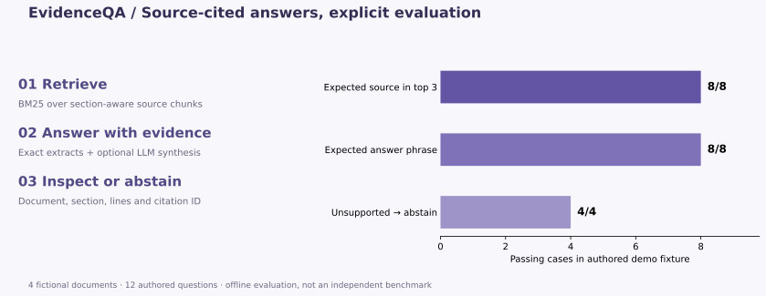

# EvidenceQA

**A document assistant whose evidence you can inspect.**

An AI-assisted portfolio implementation by **Vikas Reddy Konreddy**: document
chunking, BM25 retrieval, source-cited answers, abstention, evaluation and an
optional LLM synthesis adapter.



**Python · information retrieval · RAG architecture · JSON API · JavaScript · tests**

## The problem

A useful document assistant needs to show where an answer comes from and what
happens when the corpus does not support a question. This project implements
an inspectable retrieval layer before adding optional generation.

The default path runs entirely offline and returns exact source extracts with
document names, section headings, line ranges and stable chunk IDs. Questions
with insufficient lexical evidence receive an explicit abstention. Optional
OpenAI Responses synthesis uses the same retrieved evidence and validates
returned citation IDs before displaying the result.

## Run the local demo

Python 3.12 is tested. **No third-party packages, API key or model download are
required for the default demo.**

```bash
python -m evidenceqa serve
```

Open **http://127.0.0.1:8020**. Try the refund, support and retention questions,
then ask about something outside the corpus. The supplied policies describe a
fictional company, Northstar, and are not real contractual or operational rules.

```bash
python -m evidenceqa ask "What is the refund window after purchase?"
python -m evidenceqa evaluate
python -m unittest discover -s tests -v
```

To index your own UTF-8 Markdown or text documents locally:

```bash
python -m evidenceqa serve --corpus ./private_corpus
```

`private_corpus/` is ignored by Git. This version supports `.md` and `.txt` files;
PDF parsing and OCR are not implemented.

## Example answer

> Refund requests are accepted within 14 calendar days after purchase. [b3257a8563c9]

Evidence: `refunds.md`, section **Refund window**, lines **5–7**. The answer
includes a source excerpt and the precise chunk that produced it. Rebuilding
the unchanged corpus preserves the chunk ID.

## Measured demo evaluation

The checked-in fixture contains **12 authored questions** about four fictional
sample documents: eight answerable questions and four unsupported questions.

| Check | Offline result |
|:--|--:|
| Expected source appears in top 3, answerable questions | 8 / 8 |
| Expected answer phrase appears, answerable questions | 8 / 8 |
| Abstains on unsupported questions | 4 / 4 |
| Returned citation IDs and quoted source text | Valid in all fixture cases |

These are small, authored smoke-evaluation results. They are **not an independent
benchmark**, a general accuracy claim, or a measurement of LLM faithfulness.
See the [full per-question output](reports/evaluation.json).

**15 automated tests passed locally**, covering source provenance, stable IDs,
known answers, abstention, invalid inputs, citation rejection, mocked synthesis,
fallbacks and HTTP endpoints. CI reruns the offline tests and evaluation.

## Optional LLM mode

Set `OPENAI_API_KEY` and `OPENAI_MODEL` in your shell, using a model available
to your account that supports Responses structured outputs. Then opt in:

```bash
python -m evidenceqa serve --enable-llm
```

The interface keeps model answers off until selected. Selecting the option
sends the question and retrieved source excerpts to the OpenAI API, which can
incur usage charges. No external requests occur in the default path.

The adapter uses a JSON schema whose citation IDs are restricted to retrieved
evidence, rejects invalid or missing citations, and falls back to local extracts
on provider errors or invalid output. Requesting `store: false` controls response
storage; it is not a promise about all provider retention policies.

The provider path has been tested with mocked responses and failures, **not a
live paid model call**. Valid citation IDs establish a reference to evidence;
they do not prove that every generated claim is entailed by it.

## Architecture and code

| Component | Responsibility |
|:--|:--|
| [retrieval.py](evidenceqa/retrieval.py) | Markdown/text chunks, line provenance, BM25 ranking |
| [answer.py](evidenceqa/answer.py) | Lexical evidence threshold, exact extracts, citations and fallback |
| [generation.py](evidenceqa/generation.py) | Optional Responses API synthesis and citation validation |
| [evaluate.py](evidenceqa/evaluate.py) | Inspectable authored fixture evaluation |
| [server.py](evidenceqa/server.py) | Local JSON API and static interface |
| [web/index.html](web/index.html) | Question form, example queries and source inspection |
| [docs/DESIGN.md](docs/DESIGN.md) | Decisions, limitations and next experiments |

`POST /api/ask` accepts JSON such as:

```json
{"question":"How long are application audit logs retained?","use_llm":false}
```

The API returns `answer`, `abstained`, `mode`, `citations` and retrieval metadata.
The demo server binds to loopback only and is not a production deployment.

## Development and references

Created in October 2026 with AI-assisted implementation and executable checks.
This is a portfolio project, not a claim of professional production deployment.
API format follows the official [Responses structured-output guide](https://developers.openai.com/api/docs/guides/structured-outputs).
